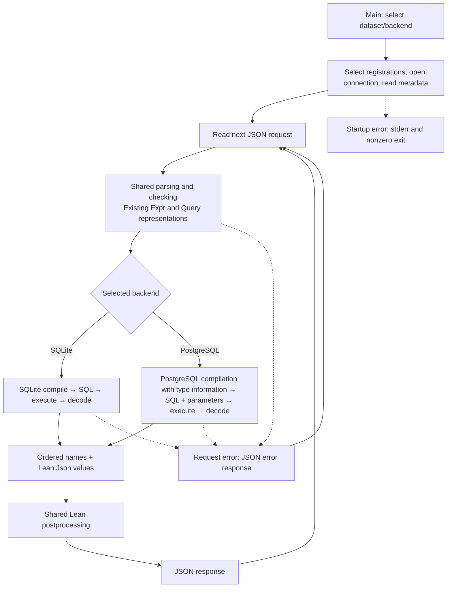

# PostgreSQL backend architecture

This document maps the requirements in [DESIGN.md](DESIGN.md) to runtime flow and module ownership. It does not introduce additional behavioral requirements. The diagrams show the target design, not completed support. Milestones and evidence belong in [IMPLEMENTATION.md](IMPLEMENTATION.md).

## Runtime flow



The request loop also handles `describe` using the shared dataset description and the selected backend's constant signatures (API-03). Startup errors and recoverable request errors are distinct (RUN-02). Each request uses the backend selected at startup; there is no fallback. Error edges are illustrative rather than exhaustive.

## Metadata and compilation inputs

| Information | Checker uses | Selected compiler uses |
| --- | --- | --- |
| Dataset metadata | Domains, fields, keys and their MathQL types | Table/column mappings, keys and field types |
| Selected backend's constants | Names and MathQL types | Matching SQL expressions and types |
| Selected backend's functions | Names and argument/result types | Matching SQL bindings and signatures |
| Checked query | Produces it | Translates it into SQL |

“Selected backend” means SQLite or PostgreSQL, never a merged registration set. Constant and function registrations supply both the checker's signatures and the compiler's matching SQL bindings (CONST-01 and FUNC-01). Names, types and values need not match between backends.

Both compilers consume the existing shared Expr/Query representation. PostgreSQL handles any additional type reasoning locally and adds casts only where required (API-02); SQLite and postprocessing need no type-annotation refactor.

## Target file structure

The tree starts at the repository's `MathQL/` package directory. Comments describe ownership; requirements remain authoritative in DESIGN.

```text
MathQL/
├── Main.lean                       # CLI, dataset registry, request loop
├── Test.lean                       # existing guards and test entry point
├── MathQL.lean                     # library exports
├── lakefile.lean
├── lake-manifest.json
├── lean-toolchain
└── MathQL/
    ├── Database.lean               # shared metadata/signature shapes; no constant or SQL function catalogue
    ├── GraphsSmallDB.lean          # domains and examples; no constant or SQL function catalogue
    ├── SymObSmallDB.lean           # domains and examples; no constant or SQL function catalogue
    ├── Expr.lean                  # existing shared expression representation
    ├── Query.lean                 # existing checked query representation
    ├── Typing.lean                # shared checking; selected signatures supplied as data
    ├── Backend.lean                # selected registrations, startup, common runner
    ├── Postprocess.lean            # existing Lean interpreter, extracted unchanged
    ├── ...                        # existing shared language modules
    ├── SQLite/
    │   ├── Compile.lean            # existing compilation, aliases and joins
    │   ├── SQLExpr.lean            # SQLite expression AST and writer
    │   ├── SQL.lean                # SQLite query AST and writer
    │   ├── Execute.lean            # connection, execution and ordered decoding
    │   ├── Column.lean             # specialized SQLite readers
    │   ├── SchemaInfo.lean         # physical columns and hidden-name exclusions
    │   ├── Functions.lean          # per-dataset complete SQL function registrations
    │   └── Constants.lean          # per-dataset names, types, SQLite.SQL.Expr registrations
    └── PostgreSQL/
        ├── Compile.lean            # compilation with type information, joins, sorting strategy
        ├── SQLExpr.lean            # PostgreSQL AST, parameters, casts, JSONB forms
        ├── SQL.lean                # SELECT writer; SQL + ordered parameters
        ├── Execute.lean            # connections, query execution, errors and result decoding
        ├── SchemaInfo.lean         # selected-schema column discovery
        ├── Functions.lean          # per-dataset complete SQL function registrations
        ├── Constants.lean          # per-dataset names, types, PostgreSQL.SQL.Expr registrations
        └── Types.lean              # local type helpers, scalar mapping, JSONB extraction
```

`python/postgresql/` at repository root contains the importer, schema SQL, conversion rules and pinned Python dependency. Test modules may be added beside the Lean package's current tests; keep pure registration/rendering checks separate from tests requiring live databases.

## Ownership and import boundaries

| Module group | Responsibility / dependency direction |
| --- | --- |
| `Name`, `Ty`, `Operators`, `Expr`, `Input`, `Query`, `Result` | Existing shared language structures; no per-node type annotations added for PostgreSQL. No backend types or SQL spellings. |
| `Parsing`, `QueryJson`, `Context`, `Rules`, `Typing` | Shared frontend; accepts selected signatures as data without changing the expression representation. |
| `Database`, dataset descriptions | Logical metadata, descriptions/examples and postprocessing registrations. No SQL AST or driver imports. Identical physical table/column names may remain in shared metadata; differing mappings belong to backends. |
| Each backend's `Functions`, `Constants` | Own complete SQL registrations; imports shared definitions and its own SQL types. Does not create server functions. |
| Each backend's `Compile`, SQL modules | Own aliases, joins, SQL compilation and SQL text generation. PostgreSQL handles additional type reasoning locally using existing checked information and small helpers, as described in API-02. |
| Each backend's `Execute`, `SchemaInfo` | Physical database operations and decoding, without postprocessing. |
| `Postprocess` | Existing `PostEnvironment`, operator/comparison evaluators, `isDefined`, `evalPostExpr`, `evalPostprocess`; imports neither driver nor backend selector. |
| `Backend` | Imports both implementations, selects one, runs it, applies postprocessing and builds the shared response. Backends do not import this selector. |
| `Main` | Parses settings, holds the explicit dataset mapping, starts the loop and delegates work. Direct driver calls move out. |
| `MathQL.lean` | Exports library modules; implementation modules import specific dependencies rather than the umbrella module. |

Move the existing root `Compile`, `SQLExpr`, `SQL`, `Column` into SQLite; split existing `Execute` between SQLite execution and Postprocess. Move SQLite metadata lookup out of Main. Update callers before removing old modules; keep forwarding modules only for a demonstrated compatibility need. Use distinct backend namespaces. `SchemaInfo`, `Column` and `Types` helpers may be combined with their backend implementation modules if that simplifies the code without changing ownership. Keep Constants and Functions explicit.
